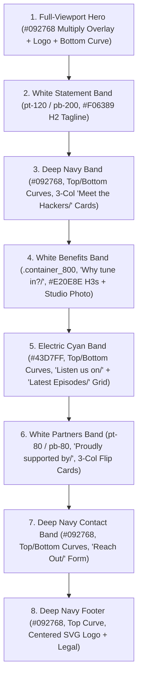

# Hacking Founders (`hackingfounders.com`) — Design Style Guide & System

This document captures the visual identity, color tokens, typography hierarchy, layout architecture, and UI component rules extracted directly from **hackingfounders.com** (`wp-content/themes/haswell-child/style.css`, homepage DOM, and brand SVG assets).

---

## 1. Brand Aesthetic & Visual Direction

- **Core Aesthetic:** Playful, high-contrast tech & entrepreneurship media identity ("Hacking Founders"). It pairs an authoritative **Deep Midnight Navy (`#092768`)** anchor with high-energy **Electric Cyan (`#43D7FF`)**, **Coral Pink (`#F06389`)**, and **Vibrant Magenta (`#E20E8E`)**.
- **Logo Anatomy (`hackingfounders-logo-no-bg.svg`):**
  - **Left:** Geometric sans-serif stacked wordmark **HACKING FOUNDERS** rendered in **Electric Cyan (`#43D7FF`)**.
  - **Right:** A human brain silhouette rendered in **Coral Pink (`#F06389`)** intersected by an ECG / audio-pulse wave, with **Electric Cyan (`#43D7FF`)** neural/circuit nodes inside the hemisphere.
- **Signature Motifs:**
  1. **Trailing Slash Header Accents (`/`):** Every major section heading terminates with a forward slash (`Meet the Hackers/`, `Why tune in?/`, `Listen us on/`, `Latest Episodes/`, `Proudly supported by/`, `Reach Out/`).
  2. **Organic Curved Section Dividers:** Full-bleed color bands (`#092768` and `#43D7FF`) transition into crisp white sections via `50px`-tall curved SVG masks (`white-oval-cover-top.svg` and `white-oval-cover-bottom.svg`).
  3. **Circular Framing & Pill Geometry:** Host/feature avatars sit inside `200px` Coral Pink circles (`border-radius: 200px`), buttons use pill radii (`20px`–`40px`), and inputs use soft `15px` rounded corners.

---

## 2. Color Palette & Token Reference

### Primary Brand Palette

| Token / CSS Variable | Hex | RGB | Role & Usage on `hackingfounders.com` |
| :--- | :--- | :--- | :--- |
| `--hf-navy` (`--color-violet-1`) | `#092768` | `9, 39, 104` | **Primary Dark Surface & Brand Anchor.** Used for hero image `multiply` overlay, fixed header, footer background, *Meet the Hackers* & *Reach Out* section backgrounds, flip-card back titles, and section headings on light/cyan backgrounds. |
| `--hf-cyan` (`--color-lightblue`) | `#43D7FF` | `67, 215, 255` | **Primary Electric Accent.** Used for the logo wordmark & neural nodes, *Listen us on / Latest Episodes* full-bleed section background, episode card hover state, and default hyperlink color. |
| `--hf-pink` (`--color-grey-1`) | `#F06389` | `240, 99, 137` | **Primary Warm Accent & CTA.** Used for the logo brain/wave graphic, hero tagline text (*"Transforming Experiences into Insights"*), `200px` circular avatar backdrops, social icon fills, primary *Send* CTA button, form links, and `9px` blockquote left borders. |
| `--hf-magenta` | `#E20E8E` | `226, 14, 142` | **Secondary Vibrant Accent.** Used for *Why tune in?* benefit subheadings (`h3`), flip-card *Learn more* buttons, and `.vckit-btn` pill buttons (hover: `#D01687`). |

### Interactive & Micro-Accents

| Token | Hex | Role & Usage |
| :--- | :--- | :--- |
| `--hf-yellow-cta-hover` | `#F2CD13` | Hover background for the primary Coral Pink submit button (`.cms-button-submit:hover`). |
| `--hf-lime-checkbox` | `#96E563` | Native `accent-color` for form consent checkboxes (`input[type="checkbox"]`). |
| `--hf-orange-border` | `#FF7104` | `5px solid` border accent on featured partner/media imagery (`border-radius: 20px`). |
| `--hf-purple-accent` | `#8B3092` | Accent text color for testimonial author attribution. |

### Neutrals & Surfaces

| Token | Hex | Role & Usage |
| :--- | :--- | :--- |
| `--hf-white` (`--white`) | `#FFFFFF` | Primary light page canvas, card back surfaces, form input backgrounds, and dark-section typography. |
| `--hf-black` (`--maincolor`) | `#000000` | Base root text token on white surfaces. |
| `--hf-gray-body` | `#646363` | Body copy color inside light editorial/benefits sections (`.benefits-section p`). |
| `--hf-gray-heading` | `#4B4E53` | Parent theme fallback heading & mobile nav link color. |
| `--hf-gray-dark` | `#434447` | Form input text color (`.contact-us-section input`). |
| `--hf-gray-muted` | `#7E8082` | Muted caption and breadcrumb text color. |

### Gradients & Blend Modes

- **Hero Overlay:** Background photograph (`topimage.jpg`) with a full-bleed `#092768` layer set to `mix-blend-mode: multiply`.
- **Episode Card Overlay (`.effect-sadie figcaption::before`):**
  ```css
  background: linear-gradient(to bottom, rgba(9, 39, 104, 0.1) 10%, rgba(9, 39, 104, 0.9) 90%);
  ```
  Transitions to solid `#43D7FF` on hover.

---

## 3. Typography System

### Font Families

1. **Primary Body & UI Font (`--mainfont` / `--extrafont`):** `'Quicksand', sans-serif`
   - Weights loaded: `300` (Light), `400` (Regular), `500` (Medium), `700` (Bold), `800` (ExtraBold).
   - Used for all body copy, `h3`–`h5` subheadings, feature cards, buttons, inputs, and footer text.
2. **Display & Section Title Font (`--titlefont`):** `'Poppins', sans-serif`
   - Weights used: `300`, `400`, `500`, `700`, `800`.
   - Used for `h1` display titles, `h2.cms-heading-inner` section headers (`54px`), and blog/article titles.
3. **Supporting Fonts:**
   - `'Open Sans', sans-serif`: Used in the Hero Slider headline (`40px` desktop / `32px` mobile) and testimonial quotes (`24px/40px`).
   - `'PT Sans', sans-serif` (`700` Bold): Used for streaming platform headers (`Spotify/`, `Apple Podcast/`, `Youtube/`).

### Type Scale & Hierarchy

| Element / Class | Font Family | Weight | Desktop Size / Line-Height | Tablet (`992–1199px`) | Mobile (`≤991px`) | Styling Notes |
| :--- | :--- | :--- | :--- | :--- | :--- | :--- |
| **Hero Display (`h1.big` / `h1`)** | `Poppins` | `400` | `110px` / `1.2` (`100px` std) | `70px` / `1.2` (`60px` std) | `56px` / `1.2` (`44px` std) | Clean geometric display |
| **Hero Slider Headline** | `Open Sans` | `400` | `40px` / `25px`–`52px` | `38px` / `52px` | `32px` / `42px` | Centered white over `#092768` multiply |
| **Section Heading (`h2.cms-heading-inner`)** | `Poppins` | `400` | `54px` / `73px` (`1.35`) | `40px` / `1.2` (`800` wt) | `36px` / `1.2` | Centered; ends with `<span class="slash-divider-10">/</span>` |
| **Standard `h2`** | `Poppins` | `700` | `38px` / `1.1` | `38px` / `1.1` | `32px` / `1.1` | Used for standalone statements |
| **Subheading (`h3`)** | `Quicksand` | `400` | `32px` / `1.2` | `30px` / `1.25` | `30px` / `1.25` | `margin-bottom: 15px` |
| **Card / Benefit Title (`.feature-card-title`, `.benefits-section h3`)** | `Quicksand` | `700` | `24px` / `30px` (`1.25`) | `24px` / `30px` | `24px` / `30px` | `#FFFFFF` on Navy cards; `#E20E8E` on White sections |
| **Lead / Feature Copy (`.feature-card-text`, `.benefits-section p`)** | `Quicksand` | `400`–`500` | `18px` / `23px` (`1.28`) | `18px` / `23px` | `18px` / `23px` | `#FFFFFF` on Navy; `#646363` on White |
| **Base Body (`p` / `--text-default`)** | `Quicksand` | `400` | `16px` / `36px` (`2.25`) | `20px` / `1.5` | `16px` / `1.5` | Airy line-height for readability |
| **Eyebrow / Category (`h4.cms-heading-inner`)** | `Quicksand` | `300` | `14px` / `1.1` | `14px` / `1.1` | `14px` / `1.1` | ` uppercase`, `letter-spacing: 3px` |
| **Footer / Legal (`.textwidget`)** | `Quicksand` | `400` | `14px` / `18px` | `14px` / `18px` | `14px` / `18px` | Links bolded (`700`) and underlined |

---

## 4. Layout & Section Architecture

The page rhythm alternates between **airy white editorial containers** and **full-bleed saturated color bands** (`#092768` Deep Navy and `#43D7FF` Electric Cyan) separated by curved SVG masks:



### Container & Spacing Rules

- **Wide Header Container (`.container-m-30`):** `max-width: 1555px`
- **Standard Grid Container (`.container`):** Bootstrap 12-column grid (`1170px` max-width, `15px` column padding)
- **Medium Container (`.container_medium .container`):** `max-width: 900px`
- **Narrow Editorial / Form Container (`.container_800`):** `max-width: 800px` centered (used for *Why tune in?* and *Reach Out*)
- **Short Content Block (`.content-short`):** `max-width: 554px`
- **Vertical Section Padding:**
  - Large sections (`.pt-120`, `.pb-120`): `120px` top and bottom on desktop; collapses to `80px` at `≤991px`.
  - Medium sections (`.pt-80`, `.pb-80`): `80px` top and bottom.
  - Extra-large sections (`.pt-240`, `.pb-240`): `240px` desktop; `80px` mobile.

---

## 5. Component Specifications

### A. "Meet the Hackers" Profile Cards (`.feature-card`)
- **Layout:** 3-column grid (`vc_col-sm-4`), centered text, `padding: 2em 1em`.
- **Avatar Frame (`.feature-card-img`):**
  - `200px × 200px` (`180px` on mobile), `border-radius: 200px`, `background-color: #F06389`, `padding: 12px`, `margin-bottom: 60px`.
  - Hover effect reveals a subtle floating shadow ellipse (`Ellipse-2.svg`) `50px` below the circle (`transition: all 0.5s`).
- **Title (`.feature-card-title`):** `24px/30px` Bold (`700`) Quicksand in `#FFFFFF`, `padding-bottom: 20px`, with a decorative vector underline (`Line-1.svg`) positioned at `bottom: 0; width: 80%; left: 10%`.
- **Description (`.feature-card-text`):** `18px/23px` Regular Quicksand in `#FFFFFF`.
- **Social Icon Badge:** Centered medium circular grey/transparent container with `#F06389` icon (`fab fa-linkedin`, `fas fa-robot`).

### B. Podcast Episode Grid / Carousel Cards (`.episodeslider` / `.effect-sadie`)
- **Layout:** 2-column interactive grid/carousel (`vc_col-md-6`) with `10px` gutter (`data-gutter="10"`).
- **Default State:** Podcast cover artwork (`1:1` square ratio) overlaid with a bottom-heavy navy gradient (`rgba(9, 39, 104, 0.1)` to `rgba(9, 39, 104, 0.9)`). Episode title sits in `#FFFFFF` at the bottom.
- **Hover State:** Card background switches to solid **Electric Cyan (`#43D7FF`)** with `#FFFFFF` text.

### C. Partner 3D Flip Cards (`.vckit-cflp-card`)
- **Dimensions:** `min-height: 300px`, 3-column row (`vc_col-sm-4`), horizontal flip (`data-layout="toright"`).
- **Front Face:** Clean white/transparent surface featuring centered partner logo (`100px–150px` or `337×112px` SVG).
- **Back Face:** `#FFFFFF` background, centered content:
  - **Title:** `18px` Quicksand in `#092768`.
  - **Subtitle:** `15px` description copy.
  - **CTA Button:** Pill button (`background-color: #E20E8E`, `#FFFFFF` text, *"Learn more"*).

### D. Buttons & Interactive Controls
1. **Primary Submit CTA (`.contact-us-section .cms-button-submit`):**
   - Background: `#F06389` (Coral Pink)
   - Text: `#FFFFFF`, `20px` Quicksand Regular (`400`), `line-height: 1`
   - Shape: `border-radius: 25px`, `padding: 20px 50px`, `min-width: 200px`
   - Hover: Background transitions to `#F2CD13` (Cyber Yellow).
2. **Secondary Action Pill (`.join-us-section .vckit-btn`):**
   - Background: `#E20E8E` (Magenta), `opacity: 0.9`
   - Text: `#FFFFFF`, `20px` uppercase or `15px` regular
   - Shape: `border-radius: 20px`, `padding: 5px 25px`
   - Hover: Background `#D01687`, `opacity: 1`.
3. **Ghost / Outline Pill (`.btn_rounded`):**
   - Border: `1px solid var(--maincolor)`
   - Shape: `border-radius: 40px` (`padding: 15px 30px`) or `border-radius: 23px` (`padding: 11px 48px`)
   - Transition: `500ms ease-out`, inverting fill and text color on hover.

### E. Form Elements (`.contact-us-section`)
- **Surface:** Placed on `#092768` Deep Navy background.
- **Text Inputs, Selects & Textareas (`.form-control`):**
  - Background: `#FFFFFF`
  - Text color: `#434447`
  - Font size: `16px` Quicksand
  - Padding: `12px 20px`
  - Border radius: `15px`
  - Vertical spacing: `margin-bottom: 25px` (`30px` on mobile)
- **Consent Checkbox:** `accent-color: #96E563`, label `opacity: 0.8`, inline links in bold underlined `#F06389`.

### F. Motion & Scroll Animations
- **Scroll Reveal (`.text_animation`, `.textblock_animation`, `wow fadeIn`):**
  - Elements translate up from `translateY(20px)` or `translateY(100%)` with `opacity: 0` to `translateY(0)` and `opacity: 1` over `800ms ease`.
- **Image Reveal (`.img_animation`):**
  - Starts desaturated (`filter: saturate(0); opacity: 0`) and transitions to full color over `800ms ease`.
- **Page Loader (`.sliderloader`):**
  - 5 neumorphic vertical pill tracks (`width: 20px; height: 80px; border-radius: 30px`) with animated `#2697F3` hue-rotating droplets (`2.5s ease-in-out infinite`).
